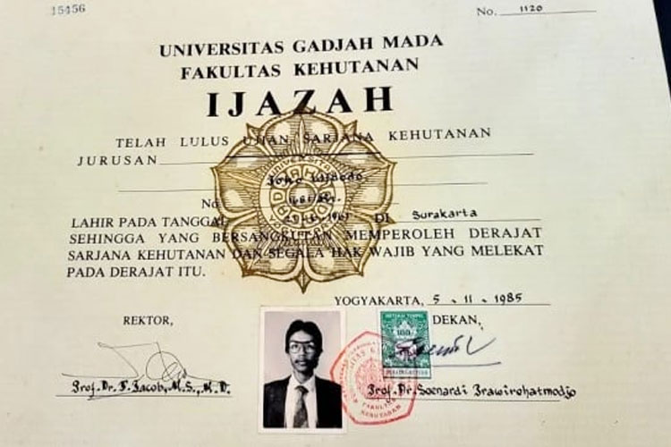
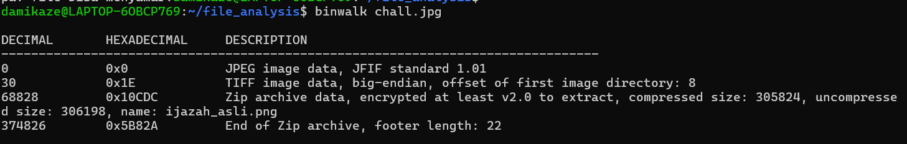
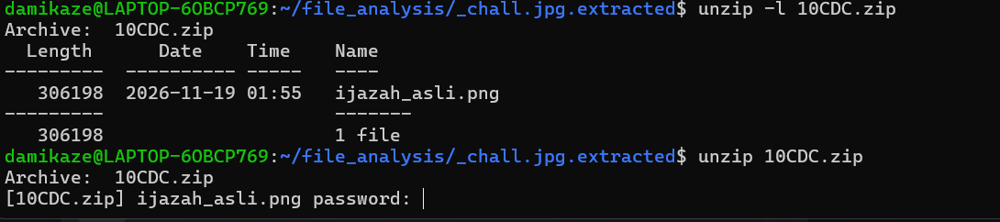
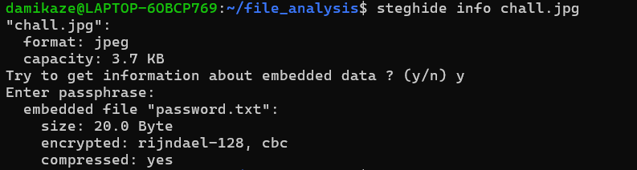
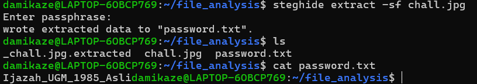
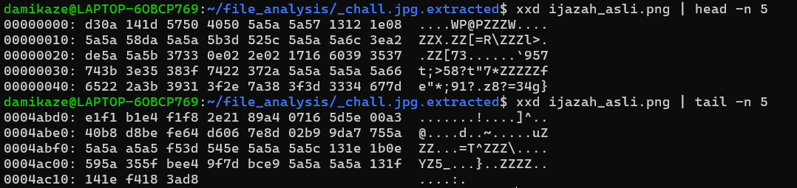
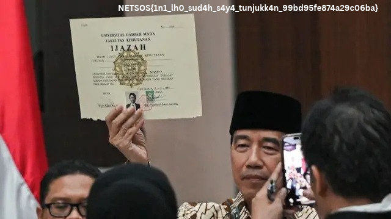

# Ijazah Jokowi Ril or Fek?

## Deskripsi
Diberikan foto ijazah, cari flagnya!  


## Solusi

- *Cek Metadata chall.jpg*  
  Lakukan `exiftool chall.jpg`, dan akan terlihat bahwa terdapat comment yang merupakan encoding base64:
  ```text
  Comment                         : SWphemFoIGluaSBwdW55YSBsYXBpc2FuLiBBZGEgeWFuZyB0ZXJzZW1idW55aSBkaSBkYWxhbSBnYW1iYXIsIGRhbiBhZGEgeWFuZyBtZW5lbXBlbCBzZXRlbGFoIGdhbWJhciBiZXJha2hpci4gSmFuZ2FuIGx1cGE6IGZpbGUgYmlzYSBtZW55YW1hci4=
  ```

  Decode base64 tersebut menggunakan:  
  `echo 'SWphemFoIGluaSBwdW55YSBsYXBpc2FuLiBBZGEgeWFuZyB0ZXJzZW1idW55aSBkaSBkYWxhbSBnYW1iYXIsIGRhbiBhZGEgeWFuZyBtZW5lbXBlbCBzZXRlbGFoIGdhbWJhciBiZXJha2hpci4gSmFuZ2FuIGx1cGE6IGZpbGUgYmlzYSBtZW55YW1hci4=' | base64 -d`

  Sehingga terlihat kalimat aslinya adalah:  
  `Ijazah ini punya lapisan. Ada yang tersembunyi di dalam gambar, dan ada yang menempel setelah gambar berakhir. Jangan lupa: file bisa menyamar.`

  Ini memberikan kita clue terhadap strutur chall.jpg itu sendiri. **ada 3 clue utama**:
  1. Ada yang tersembunyi di dalam gambar ~> Steganografi
  2. Ada yang menempel setelah gambar berakhir ~> File Concatenation
  3. File bisa menyamar ~> ekstensi tidak menjamin format file

---

- *Cek Clue Kedua*  
  Kita cek dari clue kedua dulu.  
  menggunakan `binwalk chall.jpg`, dapat terlihat bahwa terdapat file .zip yang disisipkan setelah .jpg berakhir:  
  

  Selanjutnya, lakukan `binwalk -e chall.jpg` untuk mengambil sisipan file .zip tersebut sehingga akan terbentuk folder baru `_chall.jpg.extracted` di direktori yang sama dengan lokasi chall.jpg.

  Pindah ke folder `_chall.jpg.extracted` menggunakan `cd`, lalu cek isi folder tersebut dengan `ls`.  
  Akan ada file zip bernama `10CDC.zip` yang merupakan sisipan di akhir chall.jpg sebelumnya. 

  Coba kita cek isi dari .zip tersebut dan coba meng-unzipnya:  
    
  Terlihat bahwa di `10CDC.zip` terdapat foto `ijazah_asli.png` yang kemungkinan merupakan flagnya.  
  Namun, kita memerlukan **password** untuk meng-unzip file tersebut.

  Darimana dapat passwordnya? kita cek clue lain!

---

- *Cek Clue Pertama*  
  Kembali ke direktori awal, lalu lakukan `steghide info chall.jpg`.  
  Ketik y untuk pertanyaan "Try to get information about embedded data ?".  
  Kosongkan saja passphrasenya.

  Sehingga hasilnya jadi begini:  
    
  Terlihat bahwa sebenarnya di chall.jpg terdapat file `password.txt` yang tertanam/embedded.

  Extract `password.txt` menggunakan `steghide extract -sf chall.jpg`:  
    
  Ternyata, isi dari `password.txt` adalah: `Ijazah_UGM_1985_Asli`

  Masukkan password tersebut untuk mengekstrak `10CDC.zip` di tahap sebelumnya.  
  Dan sekarang, kita sudah punya `ijazah_asli.png` di `_chall.jpg.extracted`!

  Apakah sudah selesai? Kita coba buka dulu menggunakan command `explorer.exe ijazah_asli.png`.  
  Nah ternyata, pembuka file foto windows tidak bisa membuka file tersebut.  
  Kenapa hal ini bisa terjadi?

---

- *Cek Clue Ketiga*  
  Kalau kita cek format file asli `ijazah_asli.png` menggunakan `file ijazah_asli.png`, akan muncul: `ijazah_asli.png: data`.  
  Formatnya ternyata bukan asli PNG (atau aslinya PNG, namun strukturnya rusak). Itu sebabnya tadi Windows tidak bisa membuka file tersebut.

  Kita cek header dan footer file menggunakan `xxd ijazah_asli.png | head -n 5` dan `xxd ijazah_asli.png | tail -n 5`:  
    
  Saya lempar ini ke AI, dan ditemukan pola bahwa setiap byte `ijazah_asli.png` bila di-XOR-kan dengan 0x5a akan membentuk header file PNG asli.

  > *header file PNG: `89 50 4E 47 0D 0A 1A 0A`

  Maka, untuk mengembalikan formatnya menjadi PNG, jalankan skrip python: 
  ```python
  python3 -c '
  data = open("ijazah_asli.png", "rb").read()
  decoded = bytes(b ^ 0x5a for b in data)
  open("flag.png", "wb").write(decoded)
  '
  ```

  Sehingga akan terbentuk `flag.png` yang kalau kita cek menggunakan command `file` akan menunjukkan bahwa format filenya sudah benar menjadi PNG.

  Kalau kita coba buka dengan `explorer.exe flag.png`, BOOM! flagnya ketemu.

  **flag: `NETSOS{1n1_lhO_sud4h_s4y4_tunjukk4n_99bd95fe874a29c06ba}`**  
  