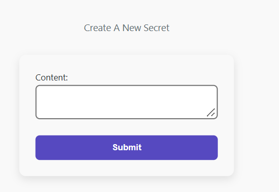
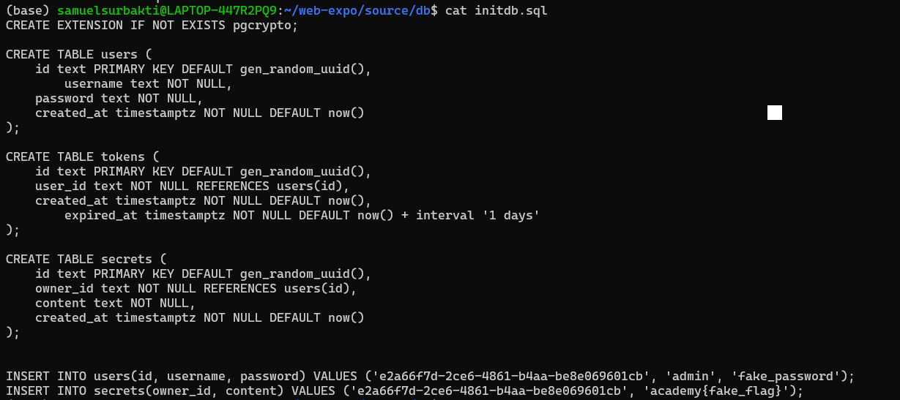

# Secret Box


## DESKRIPSI 
This secret box is designed to conceal your secrets.

It's perfectly secure—only you can see what's inside.

Or can you? Try uncovering the admin's secret. Browse [here]
, can you find the secret message?

Download the source code [here]


## OVERVIEW
- sql injection adalah sebuah celah keamanan yang di mana kita bisa memberikan payload SQL sehingga bisa mengakses database dari aplikasi 


## SOLUSI

Hal yang pertama yang kulakukan adalah melihat web yang diberikan

saat terbuka kita bisa:
- sign up akun
- login akun 
- create note 
- melihat note 



dari awal melihat form ini, aku udah curiga bahwa chall ini tentang sql injection

lanjut, kita lihat source code yang diberikan 

saat dibuka, kita bisa melihat:
- App code
- docker-compose.yml
- database dengan DBMS postgre

lalu, aku tertarik dengan file initdb.sql




kita bisa melihat ada 3 table, yaitu:
- users (user_id sebagai pk)
- tokens (akan diberikan ke user untuk mengakses current user_id)
- secrets 

kita bisa melihat pada inisiasi akan ditambahkan user admin dengan userId 'e2a66f7d-2ce6-4861-b4aa-be8e069601cb' yang seharusnya disembunyikan(?)

dan juga flag yang dibuat oleh admin ke tabel secrets.  

> JADI, KITA TAHU BAGAIMANA MENDAPATKAN FLAG, YAITU DENGAN MELIHAT ISI DARI SECRET admin


kita juga menemukan [server.js](server.js) di dalam aplikasinya yang memberitahukan bagaimana amplikasi akan berurusan dengan database

**BAGAIMANA APLIKASI MENAMPILKAN SECRET?**


```
app.get('/', authMiddleware, async (req, res) => {
        const userId = req.userId;

        if (userId){
                // logged in
                const query = await db.raw(
                        `SELECT * FROM secrets WHERE owner_id = ?`,
                        [userId]
                );

                return res.render('my_secrets', {secrets: query.rows});
        }
        else {
                // if not yet login
                return res.render('index', {message: null, error: null});
        }
});
```

secret ditampilkan dengan query biasa dengan menggunakan WHERE owner_id

awalnya aku berpikir, ya tinggal ganti userID, tapi itu salah 

karena kita tidak bisa memanipulasi userID dikarenakan kita hanya diberikan sebuah token, sedangkan aplikasi mengambil userID dari token

dan tentu kita tidak bisa tahu token dari admin.


**BAGAIMANA APLIKASI MEMBUAT SECRET?**

```
app.post('/secrets/create', authMiddleware, async (req, res) => {
        const userId = req.userId;
        if (!userId){
                // if user didn't login, redirect to index page
                res.clearCookie('auth_token');
                return res.redirect('/');
        }

        const content = req.body.content;
        const query = await db.raw(
                `INSERT INTO secrets(owner_id, content) VALUES ('${userId}', '${content}')`
        );

        return res.redirect('/');
});
```

aplikasi akan menginsert secret dengan menggunakan owner_id dan content

> Kita memang tidak bisa mengubah owner id untuk melihat secret yang telah dibuat oleh admin
> Tetapi bagaimana jika bisa login sebagai admin langsung?

kita bisa men-abuse query insert dengan memanfaatkan input content sebagai payload sql injection kita

dengan memberi payload:  `' || SELECT password FROM Users WHERE user_id =  'e2a66f7d-2ce6-4861-b4aa-be8e069601cb' || '`

kita bisa menampilkan password dari admin

Setelahnya, kita bisa login sebagai admin dan melihat admin secret yang berupa flag 


## FLAG

academy{sq1_1nject10n_2b649535}

## KESIMPULAN 
- Aplikasi seharusnya meng-handle keamanan form input agar anti sql injection
